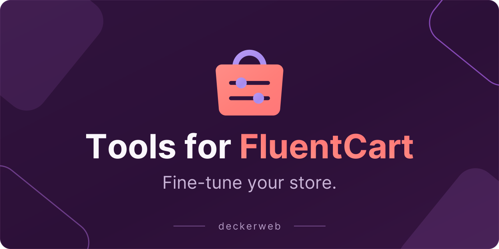
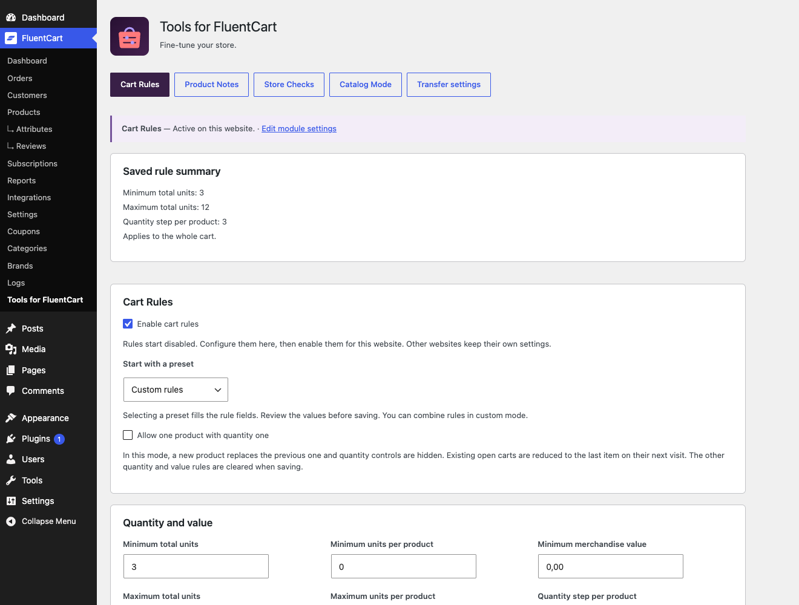
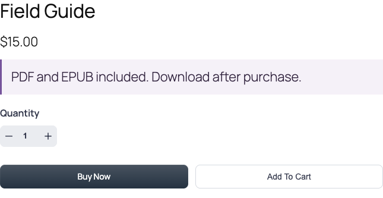
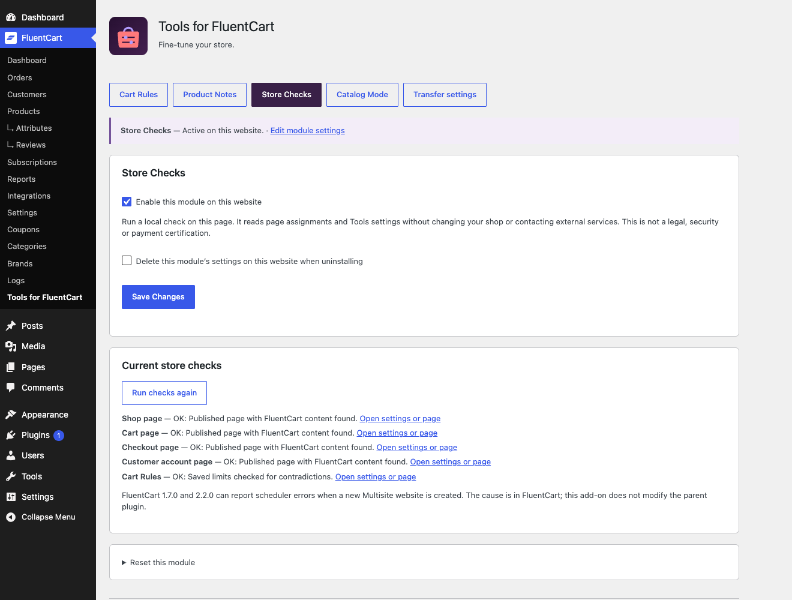

# Tools for FluentCart

[Deutsch](README-de.md)

## About

Fine-tune your FluentCart shop with a focused add-on: guide orders with Cart Rules, explain products with Product Notes, review store setup and pause purchases with Catalog Mode. Each module is optional and configured separately for each website.

Version **1.0.0** · WordPress **7.1.2+** · PHP **8.2+** · FluentCart **1.7.0+**

[User guide](docs/DOCUMENTATION.md) · [FAQ](docs/FAQ.md)

[About](#about) · [At a Glance](#glance) · [Getting started](#installation) · [Features](#features) · [FAQ](#faq) · [Changelog](#changelog) · [Project](#project) · [Security and support](#security) · [License](#license)

## At a Glance

- Exactly one item, quantity limits, quantity steps and minimum merchandise value.
- Apply custom rules to all products or selected products and their variations.
- Short product notes after prices, after descriptions or beside cart items.
- Local checks for shop pages and contradictory rules.
- Catalog mode keeps products and prices visible while blocking new purchases.
- Saved rule summary, sample test, module status, settings transfer and individual reset.

## Getting started

1. Install and activate FluentCart 1.7.0 or later, then upload the Tools for FluentCart ZIP under Plugins → Add Plugin → Upload Plugin.
2. Open FluentCart → Tools for FluentCart. Start with Cart Rules or another module. All new modules start switched off.
3. Configure and save the module, inspect its status and test the storefront as a customer. For Catalog Mode, clear your page caches when switching.
4. If FluentCart is missing or unsupported, settings remain accessible under Settings → Tools for FluentCart. Dependent fields are read-only and server-side changes are blocked.

## Features

### A cart that follows your order rules

For a one-book giveaway, enable One item only: a new product replaces the previous one and quantity remains one. For packs or small wholesale orders, combine minimums, maximums and quantity steps. Ordinary limits block checkout instead of silently changing quantities.

### Product information where it helps

Use Product Notes for facts such as “PDF and EPUB included” or “Suitable for indoor use.” Select products and a native display position. Plain text stays plain text; HTML and shortcodes in note text are not executed.

### Find missing shop pages before customers do

Store Checks reads the assigned shop, cart, checkout and account pages. It identifies missing or unpublished pages and looks for native FluentCart content. Open the relevant settings or page directly. Custom builder output requires a manual check.

### Keep the catalog, pause new purchases

Catalog Mode leaves products and prices visible, removes native purchase controls and blocks native cart additions and checkout on the server. Add an optional public message and contact link. The restriction applies to administrators as well.

## FAQ

### Does this replace FluentCart?

No. This is an add-on for an active FluentCart installation. FluentCart owns products, carts, customers, orders and payments. Tools adds optional shop helpers.

### Which module should I start with?

For purchase limits use Cart Rules. For explanatory product text use Product Notes. For checking page assignments use Store Checks. Use Catalog Mode when products should remain visible but new online purchases should stop.

### Can I restrict rules to some products?

Yes. Custom quantity and value limits can count selected parent products and all their variations. Other cart rows do not contribute. One-item mode is always cart-wide. Product IDs are specific to each website.

### Will my current rules change after updating?

Existing Cart Rules settings are retained. New modules start disabled. An empty product selection retains the previous cart-wide scope. Imports deliberately switch imported modules off until reviewed.

### What does Catalog Mode block?

It blocks native storefront cart purchases and checkout, including direct checkout links. Native purchase regions are hidden when the renderer supports this; older views have a scoped CSS fallback. Data is retained. Check custom layouts, caches and external payment flows separately.

### What happens without FluentCart?

The plugin remains active in the admin, with its settings under WordPress Settings. Dependent modules pause and preserve saved settings. Rule and module changes are blocked on the server; export and uninstall preferences remain available.

### Does it work in Multisite?

Settings are separate per website. FluentCart 1.7.0, 2.2.0 and 2.3.0 have an upstream scheduler issue during new website creation. Tools documents that issue and does not change FluentCart code.

[FAQ by topic](docs/FAQ.md)

## Changelog

### 1.0.0

- **New:** Product Notes, Store Checks and Catalog Mode; selected-product rules, saved summaries, sample tests, settings transfer and individual module reset.
- **Improved:** Supports FluentCart 1.7.0 and later through native interfaces; refreshed graphics and illustrated guides.
- **Fixed:** Minimum order values respect the native cart currency quote in FluentCart 2.x.

### 0.9.1 · 2026-10-22

- **Improved: Updated shared Library and updater integration; protected paused rule settings and improved admin notices, save confirmations and changelog dialog reliability.

### 0.9.0 · 2026-10-07

- New: Cart Rules with single-item carts, minimum quantities and order value, quantity limits and steps.

### 0.1.0–0.8.0

- **Misc:** Development and test versions; not publicly released.

## Project

Developed and published by David Decker – DECKERWEB. An add-on for FluentCart, part of the Tools series.

## Security and support

Report vulnerabilities privately through the plugin repository’s Security → Report a vulnerability workflow. Include plugin, FluentCart, WordPress and PHP versions, reproduction steps and impact, without passwords or customer data. Ordinary issues may be reported in Issues. Do not publish security details in public issues.

[Issues](https://github.com/deckerweb/tools-for-fluentcart/issues) · [Discussions](https://github.com/deckerweb/tools-for-fluentcart/discussions) · [Security](https://github.com/deckerweb/tools-for-fluentcart/security/policy) · [Ko-fi](https://ko-fi.com/deckerweb)

## License

Copyright © 2026 David Decker – DECKERWEB. GPL v2 or later; SPDX: GPL-2.0-or-later. Embedded deckerweb Plugin Library 1.2.0 and deckerweb Updater 2.3.0 are by the same author, GPL-2.0-or-later. Their stable runtime sources are copied unchanged; host adapters and translation catalogs are separate. No FluentCart implementation or premium code is distributed in this plugin.

Artwork: original native vectors, Inter font outlines under SIL OFL 1.1; license in assets-github/Inter-OFL-LICENSE.txt. Shared components: Library 1.2.0 and updater 2.3.0, GPL-2.0-or-later. No FluentCart code is bundled.

[Website](https://deckerwebplugins.com/en/plugins/tools-for-fluentcart/)
