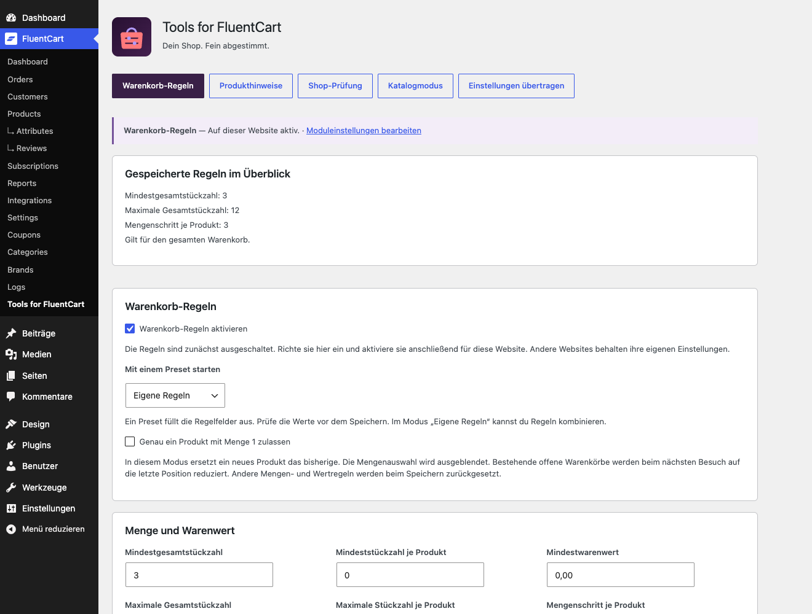
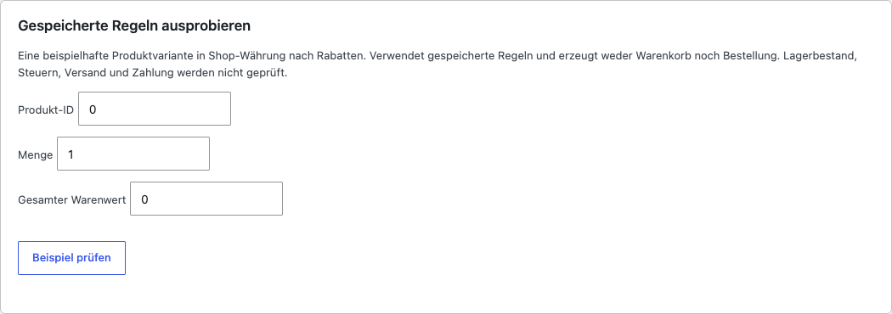
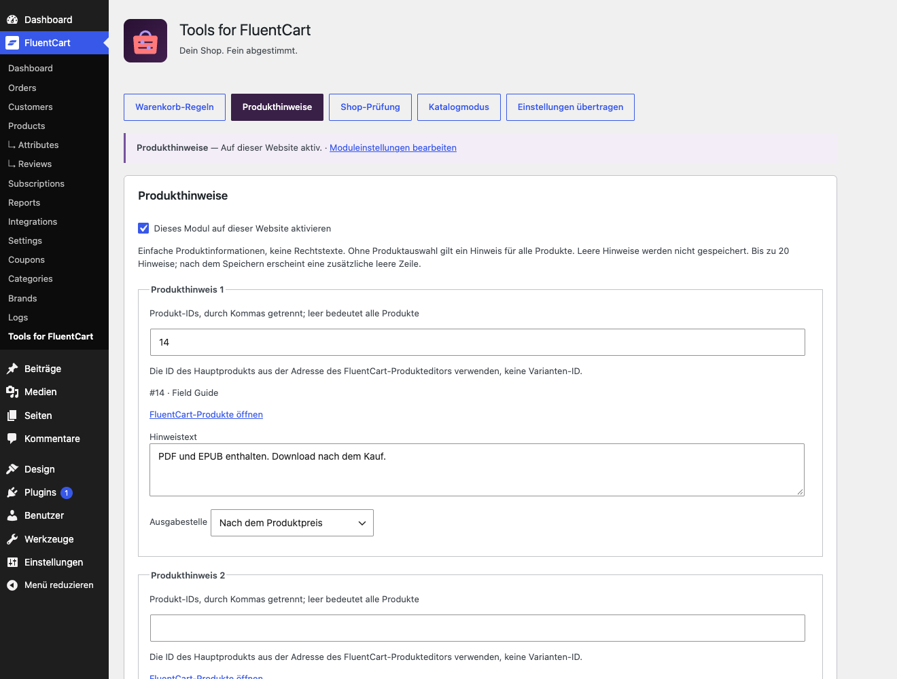
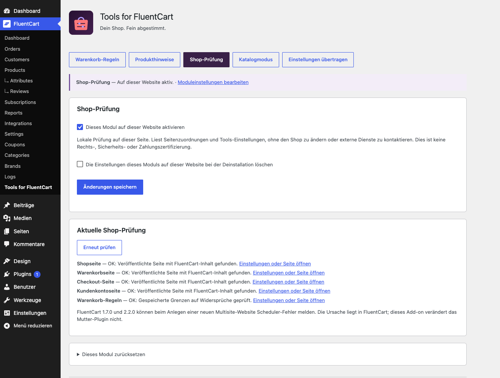
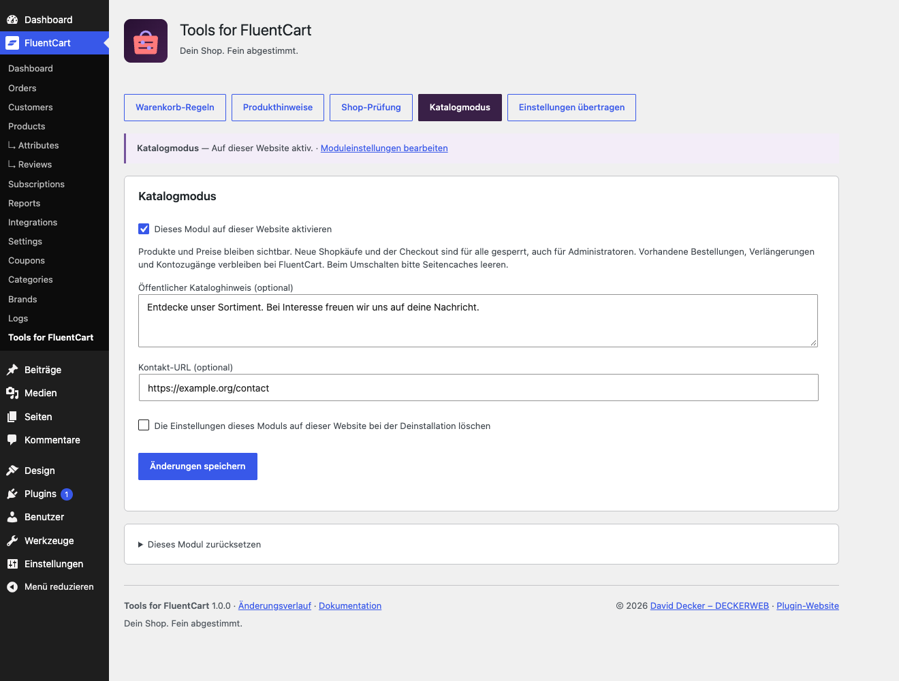
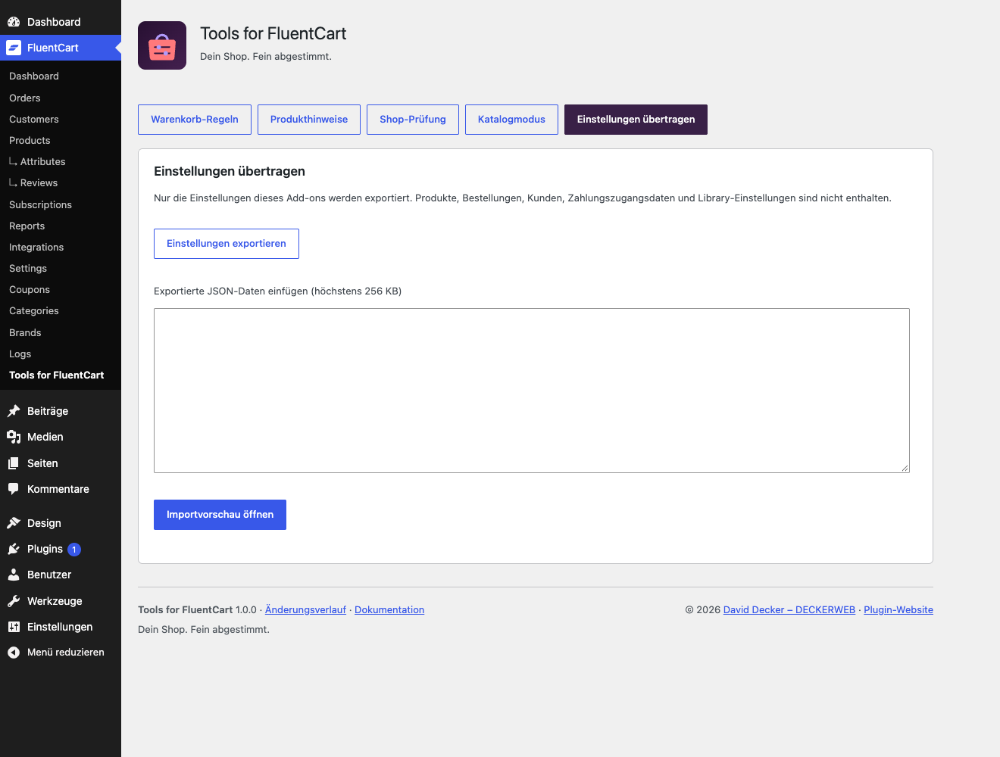
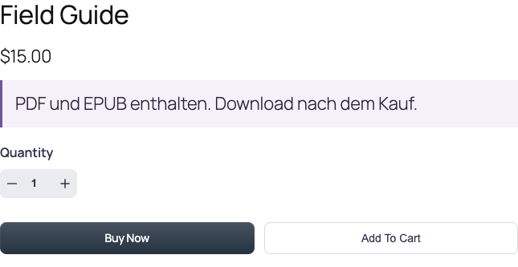
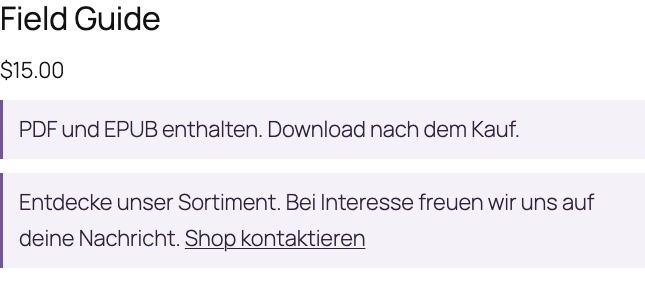

# Tools for FluentCart: Anleitung für Shopbetreiber

[English](DOCUMENTATION.md) · [FAQ](FAQ-de.md)

Ein gezieltes Add-on für deinen FluentCart-Shop: Bestellungen mit Warenkorb-Regeln steuern, Produkte verständlich erklären, die Shopeinrichtung prüfen und Käufe bei Bedarf mit dem Katalogmodus pausieren. Jedes Modul ist optional und wird pro Website eingerichtet.

## Erste Schritte

1. Installiere und aktiviere FluentCart ab 1.7.0. Lade anschließend die Tools-for-FluentCart-ZIP unter Plugins → Plugin hinzufügen → Plugin hochladen hoch.
2. Öffne FluentCart → Tools for FluentCart und beginne mit Warenkorb-Regeln oder einem anderen Modul. Alle neuen Module sind zunächst ausgeschaltet.
3. Richte das Modul ein, speichere und prüfe Status und Shopansicht als Kunde. Beim Umschalten des Katalogmodus leere die Seitencaches.
4. Fehlt FluentCart oder wird die Installation nicht unterstützt, erreichst du die Einstellungen unter Einstellungen → Tools for FluentCart. Abhängige Felder sind schreibgeschützt; Änderungen werden auch auf dem Server blockiert.

## Warenkorb-Regeln einrichten

Öffne Warenkorb-Regeln, wähle ein Preset, passe die Grenzen an und speichere. Die Zusammenfassung beschreibt gespeicherte Werte, keine ungespeicherten Änderungen. Null schaltet eine Grenze aus; Mengenschritt 1 erlaubt jede ganze Menge. Ein Schritt von 6 erlaubt je Variante 6, 12, 18 usw. Der Mindestwarenwert gilt in Shop-Währung nach Rabatten, ohne Versand und Gebühren. Native Warenkorb-Währungskurse werden in FluentCart 2.x berücksichtigt.

*Warenkorb-Regeln einrichten — Beispielansicht mit neutralen Shopdaten.*

## Regeln auf ausgewählte Produkte beschränken

Trage unter Produktauswahl die WordPress-Produkt-IDs durch Kommas getrennt ein. Die gespeicherten Titel helfen bei der Kontrolle. Alle Varianten dieser Produkte zählen mit. Gesamtmenge und Warenwert berücksichtigen nur passende Positionen; andere Produkte erfüllen die Mindestgrenze nicht. Ohne ein ausgewähltes Produkt im Warenkorb greift keine solche Anforderung. Jede Variante zählt weiterhin einzeln. Eine leere Auswahl gilt für den gesamten Warenkorb. Der Ein-Artikel-Modus gilt immer für den ganzen Warenkorb und löscht beim Speichern andere Grenzen sowie die Auswahl.

## Eine Regel ohne Bestellung ausprobieren

Verwende Gespeicherte Regeln ausprobieren mit einer Beispiel-Produkt-ID, Menge und dem gesamten Warenwert nach Rabatten. Der Test verwendet gespeicherte Einstellungen in Shop-Währung. Er erzeugt weder Warenkorb noch Bestellung und prüft nicht Lagerbestand, Steuern, Versand oder Zahlung. Ausgeschaltete Regeln oder Produkte außerhalb der Auswahl erzeugen keine Anforderung. Teste anschließend immer auch den echten Shopablauf.

*Eine Regel ohne Bestellung ausprobieren — Beispielansicht mit neutralen Shopdaten.*

## Hilfreiche Produkthinweise ergänzen

Aktiviere Produkthinweise. Trage einen kurzen Text ein, wähle Produkte oder lasse die Auswahl für alle leer. Wähle Nach dem Produktpreis, Nach der Produktbeschreibung oder Bei der Warenkorbposition. Nach dem Speichern erscheint eine weitere leere Zeile. Bis zu 20 Hinweise sind möglich. Zum Entfernen leerst du den Text und speicherst. Die Stellen nutzen native FluentCart-Ausgabehooks; in eigenen Layouts kannst du [tffc_product_note id="123"] gezielt platzieren. Der Shortcode zeigt alle passenden Hinweise für dieses veröffentlichte Produkt.

*Hilfreiche Produkthinweise ergänzen — Beispielansicht mit neutralen Shopdaten.*

## Die Shopeinrichtung prüfen

Aktiviere die Shop-Prüfung und öffne ihren Reiter für aktuelle Ergebnisse. Erneut prüfen lädt den lokalen Bericht neu. Prüfen bedeutet Handlungsbedarf oder eine nötige manuelle Kontrolle; eine Seite muss deshalb nicht defekt sein. Builder-Inhalte können auch ohne gefundenen nativen Shortcode oder Block korrekt funktionieren. Die Prüfung bestellt nichts, testet keine Zahlungsanbieter und zertifiziert keine Rechtssicherheit.

*Die Shopeinrichtung prüfen — Beispielansicht mit neutralen Shopdaten.*

## Den Katalogmodus verwenden

Ergänze optional eine Erklärung mit Kontakt-URL, speichere und aktiviere den Katalogmodus. Prüfe Produktseiten, Shoplisten und einen direkten Checkout-Link. Leere Seiten- und CDN-Caches beim Ein- und Ausschalten. Vorhandene Bestellungen und Produkte werden nicht gelöscht. Kontozugänge und automatische Verlängerungen verwaltet weiterhin FluentCart; das Modul pausiert keine Abos und storniert keine vorhandenen Bestellungen. Zahlungswege anderer Anbieter und zwischengespeicherte oder eigene Kaufwidgets müssen gesondert geprüft werden.

*Den Katalogmodus verwenden — Beispielansicht mit neutralen Shopdaten.*

## Einstellungen sicher übertragen

Öffne Einstellungen übertragen → Einstellungen exportieren. Füge die JSON-Daten auf der Zielwebsite ein und öffne die Importvorschau. Prüfe die Werte und bestätige den Import. Nur aufgeführte Tools-Module werden ersetzt; die Module sind anschließend ausgeschaltet, Löschoptionen bleiben erhalten. Produkt-IDs gelten pro Website: vor dem Aktivieren prüfen. Produkte, Bestellungen, Kunden, Zahlungszugangsdaten, Library- und Updater-Einstellungen werden nicht kopiert. Die JSON-Grenze beträgt 256 KB.

*Einstellungen sicher übertragen — Beispielansicht mit neutralen Shopdaten.*

## Gezielt zurücksetzen

Öffne Dieses Modul zurücksetzen, bestätige das Kontrollkästchen und führe die Aktion aus. Nur dieses Modul erhält ausgeschaltete Standardwerte. Andere Module und Löschoptionen bleiben erhalten. Deaktivieren erhält alle Einstellungen. Auch Deinstallation erhält sie, sofern die Löschoption des jeweiligen Moduls auf dieser Website nicht aktiviert war. FluentCart-Produkte, Bestellungen, Warenkörbe und Kundendaten werden niemals gelöscht.

## Multisite und Kompatibilität

Tools speichert Einstellungen je Website, auch bei Netzwerkaktivierung. Es entsteht keine netzwerkweite Bestellregel. Neue Websites starten mit ausgeschalteten Standardwerten. Für FluentCart 1.7.0, 2.2.0 und 2.3.0 ist ein Scheduler-Timingfehler beim Erstellen neuer Multisite-Websites bestätigt; die Ursache liegt in FluentCart, nicht im Add-on. Das Add-on verändert das Mutter-Plugin nicht. Teste Abos, Bundles, Zusatzangebote und eigene Shopansichten mit den gewählten Regeln. Echte Zahlungen und sämtliche Pro-Integrationen sind nicht durch eine pauschale Kompatibilitätszusage abgedeckt.

## Ergebnis im Shop

