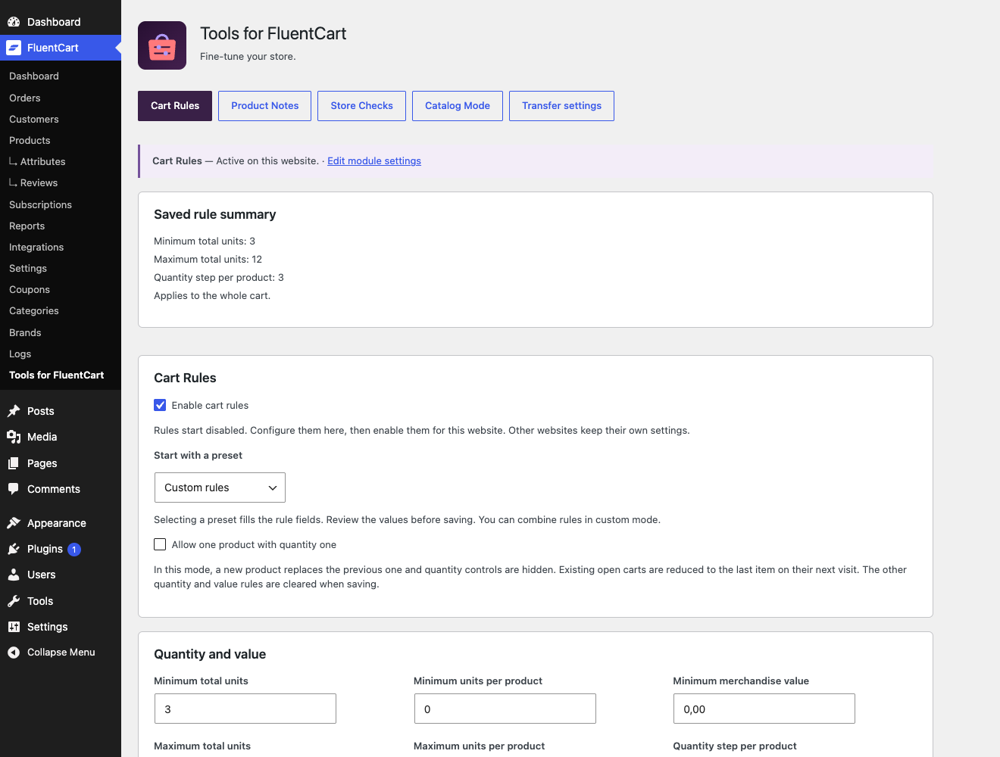
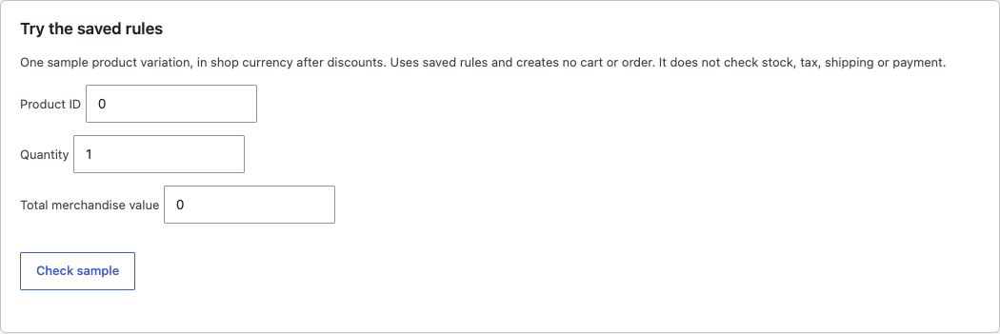
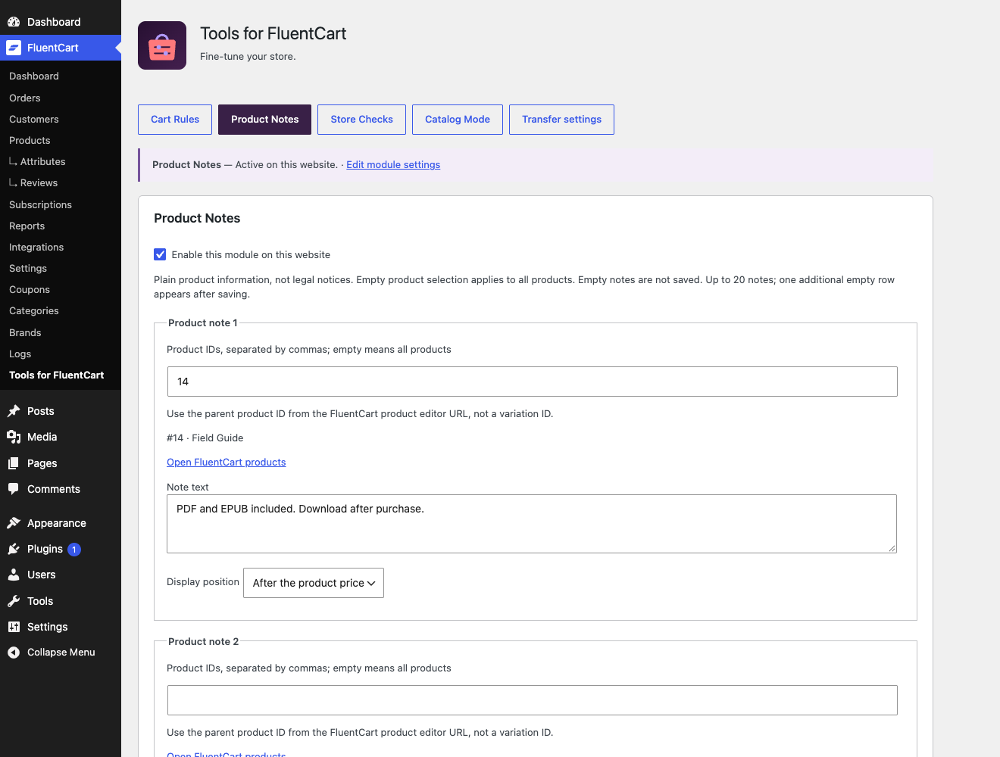
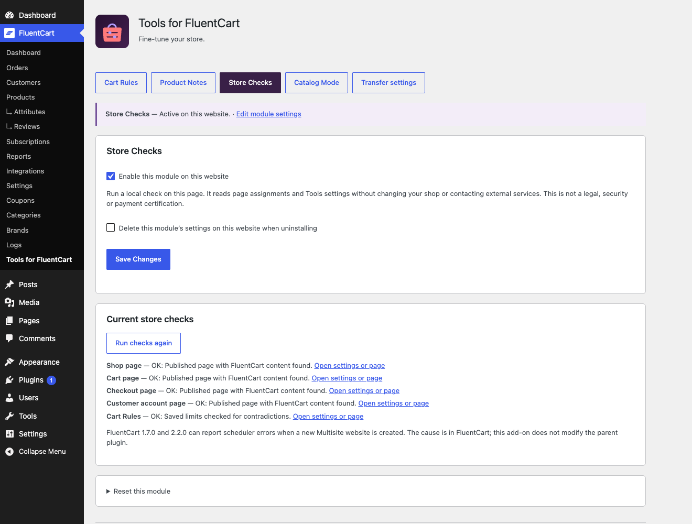
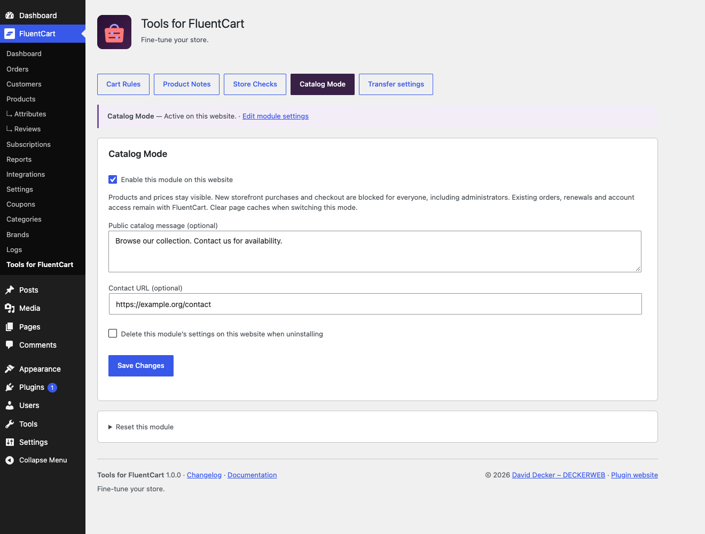
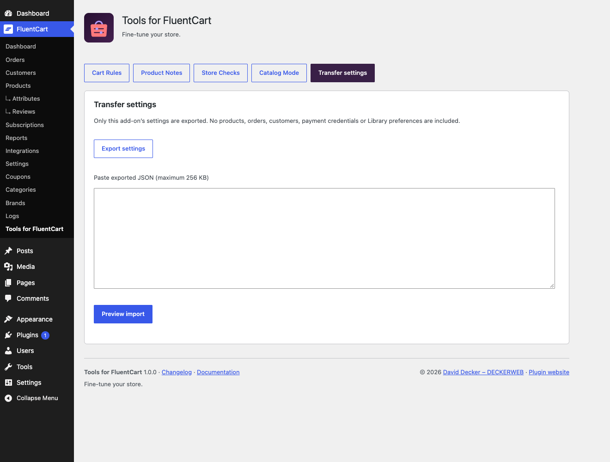
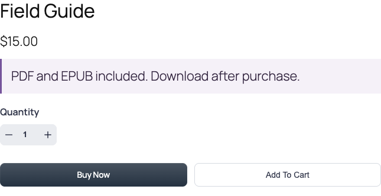
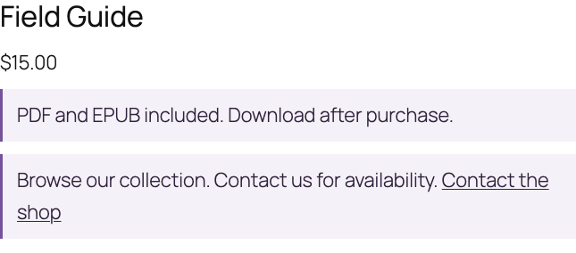

# Tools for FluentCart: shop owner’s guide

[Deutsch](DOCUMENTATION-de.md) · [FAQ](FAQ.md)

Fine-tune your FluentCart shop with a focused add-on: guide orders with Cart Rules, explain products with Product Notes, review store setup and pause purchases with Catalog Mode. Each module is optional and configured separately for each website.

## Getting started

1. Install and activate FluentCart 1.7.0 or later, then upload the Tools for FluentCart ZIP under Plugins → Add Plugin → Upload Plugin.
2. Open FluentCart → Tools for FluentCart. Start with Cart Rules or another module. All new modules start switched off.
3. Configure and save the module, inspect its status and test the storefront as a customer. For Catalog Mode, clear your page caches when switching.
4. If FluentCart is missing or unsupported, settings remain accessible under Settings → Tools for FluentCart. Dependent fields are read-only and server-side changes are blocked.

## Set up Cart Rules

Open Cart Rules, choose a preset, adjust the limits and save. The saved summary describes the stored configuration, not unsaved changes. Zero disables a limit; quantity step 1 permits every whole quantity. A step of 6 permits 6, 12, 18 and so on for each variation. Minimum merchandise value uses shop currency after discounts, without shipping or fees. Native cart currency quotes are respected in FluentCart 2.x.

*Set up Cart Rules — Example with neutral shop data.*

## Limit the rule to selected products

Enter comma-separated WordPress product IDs in Product selection. The saved titles help verify the selection. All variations of those products count. Total quantity and merchandise value count only matching rows; unrelated products cannot fulfill the minimum. A cart without matching products has no selected-product requirement. Each variation still counts separately. Leave the selection empty for the whole cart. One-item mode always covers the whole cart and clears other limits and the selection when saved.

## Try a rule without ordering

Use Try the saved rules with one sample product ID, quantity and total merchandise value after discounts. The test uses saved settings in shop currency. It creates no cart or order and does not test stock, tax, shipping or payment. Disabled rules or products outside the selection create no requirement. Always test the actual storefront afterward.

*Try a rule without ordering — Example with neutral shop data.*

## Add helpful product notes

Enable Product Notes. Enter a short note, choose products or leave the selection empty for all, then choose After the product price, After product content or Beside the cart item. Save; another empty row becomes available. Up to 20 notes are supported. Clear a note’s text and save to remove it. Positions use native FluentCart rendering hooks; custom layouts can place [tffc_product_note id="123"] explicitly. The shortcode displays all matching notes for that published product.

*Add helpful product notes — Example with neutral shop data.*

## Check your store setup

Enable Store Checks and open its tab to read current results. Run checks again refreshes the local report. Review means action or a manual check is needed; it is not always a broken page. Builder-generated content may be valid even when no native shortcode or block is present. The check does not place orders, test gateways or certify legal compliance.

*Check your store setup — Example with neutral shop data.*

## Use Catalog Mode

Add an optional explanation and contact URL, save and enable Catalog Mode. Test product pages, shop listings and a direct checkout link. Clear page and CDN caches both when enabling and disabling the mode. Existing orders and products are not deleted. Account access and automatic renewals remain managed by FluentCart; this module is not a subscription pause or an existing-order cancellation tool. Third-party payment endpoints and cached/custom purchase widgets need their own checks.

*Use Catalog Mode — Example with neutral shop data.*

## Move settings safely

Open Transfer settings → Export settings. Paste the JSON into the destination website and choose Preview import. Review the values and confirm the import. Only listed Tools modules are replaced; modules are switched off after import and deletion preferences remain unchanged. Product IDs are website-specific: review them before enabling. Products, orders, customers, payment credentials, Library and updater settings are not copied. JSON is limited to 256 KB.

*Move settings safely — Example with neutral shop data.*

## Reset only what you intend

Open Reset this module, confirm the checkbox and apply. Only that module returns to disabled defaults. Other modules and deletion preferences remain unchanged. Deactivation preserves all settings. Uninstall preserves each module unless its per-website deletion option was enabled. FluentCart products, orders, carts and customer records are never deleted.

## Multisite and compatibility

Tools stores independent settings on each website, including network activation. No network-wide order policy is created. Newly created websites start with disabled defaults. FluentCart 1.7.0, 2.2.0 and 2.3.0 have a confirmed upstream scheduler timing issue when creating a new Multisite website; the cause is in FluentCart, not this add-on. The add-on does not patch the parent plugin. Test subscriptions, bundles, order bumps and custom storefronts with the chosen rules. Real paid transactions and every Pro integration are not covered by a blanket compatibility promise.

## Storefront result

