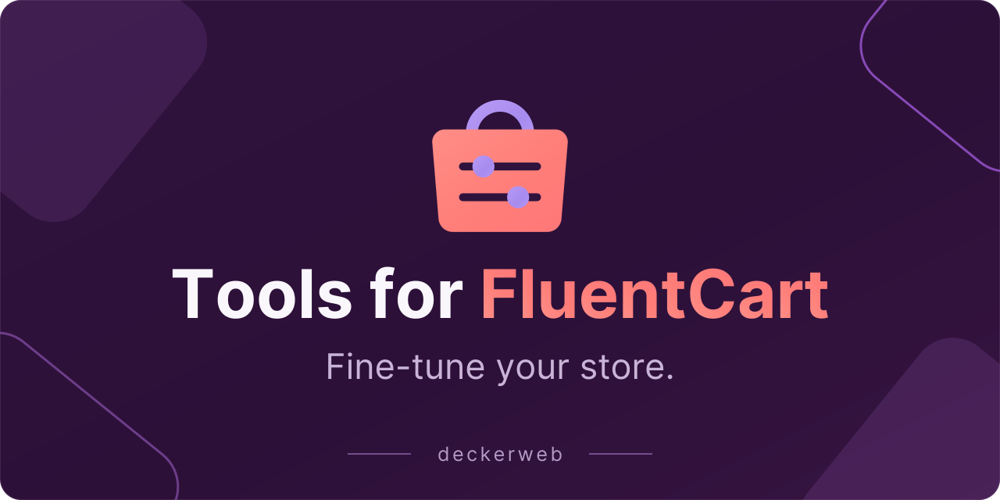

# Tools for FluentCart

## English

**Fine-tune your store.** Optional Cart Rules, Product Notes, Store Checks and Catalog Mode for your FluentCart shop.

[Plugin website](https://deckerwebplugins.com/en/plugins/tools-for-fluentcart/) · [User guide](https://github.com/deckerweb/tools-for-fluentcart/wiki/Documentation) · [FAQ](https://github.com/deckerweb/tools-for-fluentcart/wiki/FAQ-by-topic) · [Download](https://github.com/deckerweb/tools-for-fluentcart/releases/latest)

## Deutsch

**Dein Shop. Fein abgestimmt.** Optionale Warenkorb-Regeln, Produkthinweise, Shop-Prüfungen und Katalogmodus für deinen FluentCart-Shop.

[Plugin-Website](https://deckerwebplugins.com/de/plugins/tools-for-fluentcart/) · [Anleitung](https://github.com/deckerweb/tools-for-fluentcart/wiki/Dokumentation) · [Fragen nach Themen](https://github.com/deckerweb/tools-for-fluentcart/wiki/Fragen-nach-Themen) · [Download](https://github.com/deckerweb/tools-for-fluentcart/releases/latest)

© 2026 David Decker – DECKERWEB. Plugin: [GPL v2 or later / GPL v2 oder höher](https://www.gnu.org/licenses/gpl-2.0.html).
