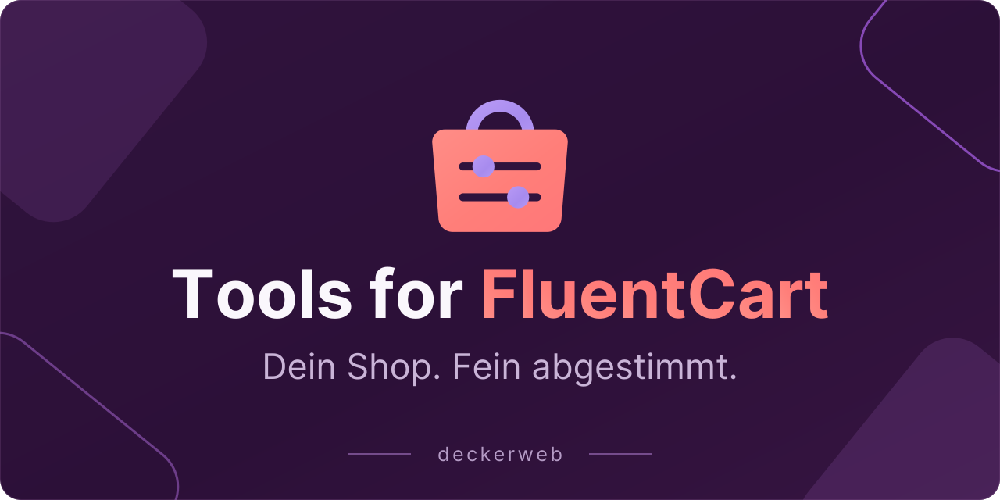
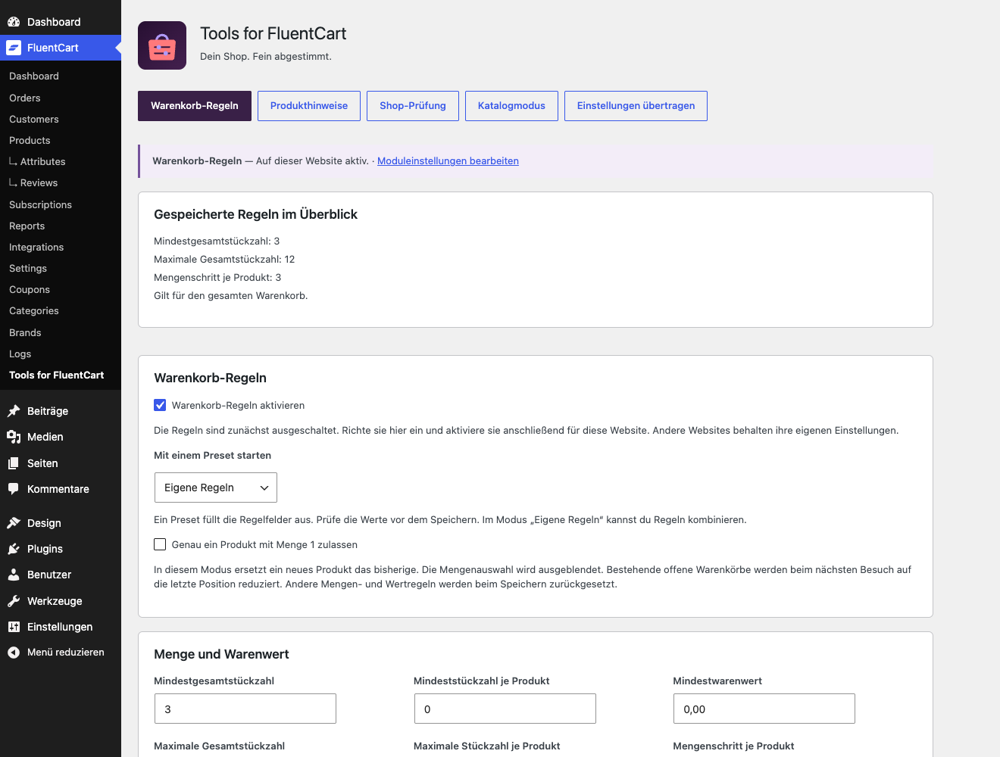
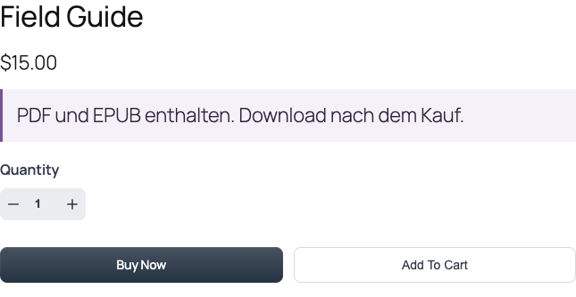
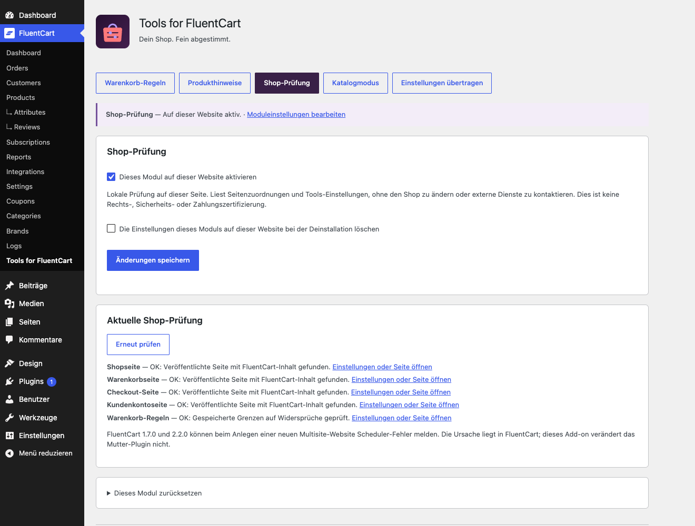

# Tools for FluentCart

[English](README)

## Kurzvorstellung

Ein gezieltes Add-on für deinen FluentCart-Shop: Bestellungen mit Warenkorb-Regeln steuern, Produkte verständlich erklären, die Shopeinrichtung prüfen und Käufe bei Bedarf mit dem Katalogmodus pausieren. Jedes Modul ist optional und wird pro Website eingerichtet.

Version **1.0.0** · WordPress **7.1.2+** · PHP **8.2+** · FluentCart **1.7.0+**

[Anleitung](Dokumentation) · [FAQ](Fragen-nach-Themen)

[Kurzvorstellung](#about) · [Auf einen Blick](#glance) · [Erste Schritte](#installation) · [Funktionen](#features) · [FAQ](#faq) · [Änderungsverlauf](#changelog) · [Projekt](#project) · [Sicherheit und Unterstützung](#security) · [Lizenz](#license)

## Auf einen Blick

- Genau ein Artikel, Mengenlimits, Mengenschritte und Mindestwarenwert.
- Eigene Regeln für alle Produkte oder ausgewählte Produkte samt Varianten.
- Kurze Produkthinweise nach Preisen, Beschreibungen oder bei Warenkorbpositionen.
- Lokale Prüfung von Shopseiten und widersprüchlichen Regeln.
- Katalogmodus: Produkte und Preise zeigen, neue Käufe pausieren.
- Gespeicherte Regeln im Überblick, Beispieltest, Modulstatus, Einstellungsübertragung und gezieltes Zurücksetzen.

## Erste Schritte

1. Installiere und aktiviere FluentCart ab 1.7.0. Lade anschließend die Tools-for-FluentCart-ZIP unter Plugins → Plugin hinzufügen → Plugin hochladen hoch.
2. Öffne FluentCart → Tools for FluentCart und beginne mit Warenkorb-Regeln oder einem anderen Modul. Alle neuen Module sind zunächst ausgeschaltet.
3. Richte das Modul ein, speichere und prüfe Status und Shopansicht als Kunde. Beim Umschalten des Katalogmodus leere die Seitencaches.
4. Fehlt FluentCart oder wird die Installation nicht unterstützt, erreichst du die Einstellungen unter Einstellungen → Tools for FluentCart. Abhängige Felder sind schreibgeschützt; Änderungen werden auch auf dem Server blockiert.

## Funktionen

### Ein Warenkorb nach deinen Bestellregeln

Für eine Buchverschenkaktion aktivierst du Genau ein Artikel: Ein neues Produkt ersetzt das bisherige, die Menge bleibt eins. Für Verkaufspakete oder kleine Großhandelsbestellungen kombinierst du Mindestmengen, Höchstmengen und Mengenschritte. Normale Grenzen sperren den Checkout, statt Mengen ungefragt zu ändern.

### Produktinformationen dort, wo sie helfen

Produkthinweise eignen sich etwa für „PDF und EPUB enthalten“ oder „Für Innenräume geeignet“. Wähle Produkte und eine native Ausgabestelle. Einfacher Text bleibt einfacher Text; HTML und Shortcodes im Hinweistext werden nicht ausgeführt.

### Fehlende Shopseiten rechtzeitig erkennen

Die Shop-Prüfung liest die zugeordneten Shop-, Warenkorb-, Checkout- und Kontoseiten. Sie erkennt fehlende oder unveröffentlichte Seiten und sucht nach nativem FluentCart-Inhalt. Öffne die betroffene Einstellung oder Seite direkt. Eigene Builder-Ausgaben müssen manuell geprüft werden.

### Katalog behalten, neue Käufe pausieren

Der Katalogmodus lässt Produkte und Preise sichtbar, entfernt native Kaufbedienelemente und sperrt native Warenkorbkäufe sowie den Checkout auf dem Server. Optional ergänzt du einen öffentlichen Hinweis mit Kontaktlink. Die Sperre gilt auch für Administratoren.

## FAQ

### Ersetzt das Plugin FluentCart?

Nein. Es ist ein Add-on für eine aktive FluentCart-Installation. Produkte, Warenkörbe, Kunden, Bestellungen und Zahlungen verwaltet FluentCart. Tools ergänzt optionale Shophelfer.

### Mit welchem Modul beginne ich?

Für Bestellgrenzen mit Warenkorb-Regeln, für erklärende Produkttexte mit Produkthinweisen und für Seitenzuordnungen mit der Shop-Prüfung. Der Katalogmodus hält Produkte sichtbar und pausiert neue Onlinekäufe.

### Kann ich Regeln auf bestimmte Produkte beschränken?

Ja. Eigene Mengen- und Wertgrenzen können ausgewählte Hauptprodukte und alle ihre Varianten zählen. Andere Positionen tragen nicht dazu bei. Der Ein-Artikel-Modus gilt immer für den ganzen Warenkorb. Produkt-IDs gehören zur jeweiligen Website.

### Ändern sich vorhandene Regeln beim Update?

Bestehende Warenkorb-Regeln bleiben erhalten. Neue Module sind ausgeschaltet. Eine leere Produktauswahl erhält den bisherigen Geltungsbereich für den ganzen Warenkorb. Importierte Module bleiben bewusst bis zur Kontrolle ausgeschaltet.

### Was sperrt der Katalogmodus?

Native Warenkorbkäufe und Checkout, einschließlich direkter Checkout-Links. Native Kaufbereiche werden bei unterstütztem Renderer entfernt; für ältere Ansichten gibt es einen begrenzten CSS-Fallback. Daten bleiben erhalten. Eigene Layouts, Caches und externe Zahlungswege gesondert prüfen.

### Was passiert ohne FluentCart?

Das Plugin bleibt im Admin aktiv; seine Einstellungen liegen dann unter WordPress-Einstellungen. Abhängige Module pausieren und erhalten ihre Werte. Regel- und Moduländerungen werden auf dem Server blockiert; Export und Löschoptionen bleiben verfügbar.

### Funktioniert es in Multisite?

Die Einstellungen gelten getrennt je Website. FluentCart 1.7.0, 2.2.0 und 2.3.0 haben beim Anlegen neuer Websites einen Scheduler-Fehler. Tools dokumentiert ihn und verändert den FluentCart-Code nicht.

[Fragen nach Themen](Fragen-nach-Themen)

## Änderungsverlauf

### 1.0.0

- **Neu:** Produkthinweise, Shop-Prüfung und Katalogmodus; Regeln für ausgewählte Produkte, gespeicherte Zusammenfassungen, Beispieltests, Einstellungsübertragung und gezieltes Zurücksetzen je Modul.
- **Verbessert:** Unterstützung für FluentCart ab 1.7.0 anhand nativer Schnittstellen; aktualisierte Grafiken und bebilderte Anleitungen.
- **Behoben:** Mindestbestellwerte berücksichtigen den nativen Warenkorb-Währungskurs in FluentCart 2.x.

### 0.9.1 · 2026-10-22

- **Verbessert: Gemeinsame Library und Update-Anbindung aktualisiert; pausierte Regelfelder geschützt sowie Admin-Hinweise, Speicherbestätigungen und Änderungsverlauf-Dialog verbessert.

### 0.9.0 · 2026-10-07

- Neu: Cart Rules mit Ein-Artikel-Warenkörben, Mindestmengen und Mindestbestellwert, Höchstmengen und Mengenschritten.

### 0.1.0–0.8.0

- **Sonstiges:** Entwicklungs- und Testversionen; nicht öffentlich veröffentlicht.

## Projekt

Entwicklung und Herausgabe: David Decker – DECKERWEB. Ein Add-on für FluentCart, Teil der Tools-Serie.

## Sicherheit und Unterstützung

Sicherheitslücken vertraulich über Security → Report a vulnerability im Plugin-Repository melden. Plugin-, FluentCart-, WordPress- und PHP-Versionen, Schritte zur Reproduktion und Auswirkungen angeben, ohne Passwörter oder Kundendaten. Normale Fehler gehören in Issues. Sicherheitsdetails nicht in öffentlichen Issues veröffentlichen.

[Issues](https://github.com/deckerweb/tools-for-fluentcart/issues) · [Discussions](https://github.com/deckerweb/tools-for-fluentcart/discussions) · [Security](https://github.com/deckerweb/tools-for-fluentcart/security/policy) · [Ko-fi](https://ko-fi.com/deckerweb)

## Lizenz

Copyright © 2026 David Decker – DECKERWEB. GPL v2 oder höher; SPDX: GPL-2.0-or-later. Eingebettete deckerweb Plugin Library 1.2.0 und deckerweb Updater 2.3.0 stammen vom selben Autor und stehen unter GPL-2.0-or-later. Ihre stabilen Laufzeitquellen sind unverändert übernommen; Host-Anbindung und Sprachkataloge liegen getrennt vor. Dieses Plugin liefert weder FluentCart-Implementierung noch Premium-Code aus.

Grafiken: eigene native Vektoren, Schrift Inter als Pfade unter SIL OFL 1.1; Lizenz in assets-github/Inter-OFL-LICENSE.txt. Gemeinsame Komponenten: Library 1.2.0 und Updater 2.3.0, GPL-2.0-or-later. Kein FluentCart-Code enthalten.

[Website](https://deckerwebplugins.com/de/plugins/tools-for-fluentcart/)
